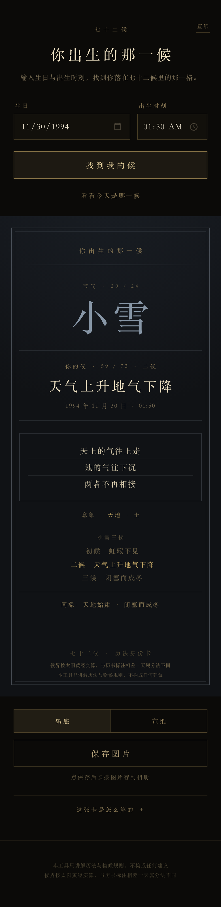
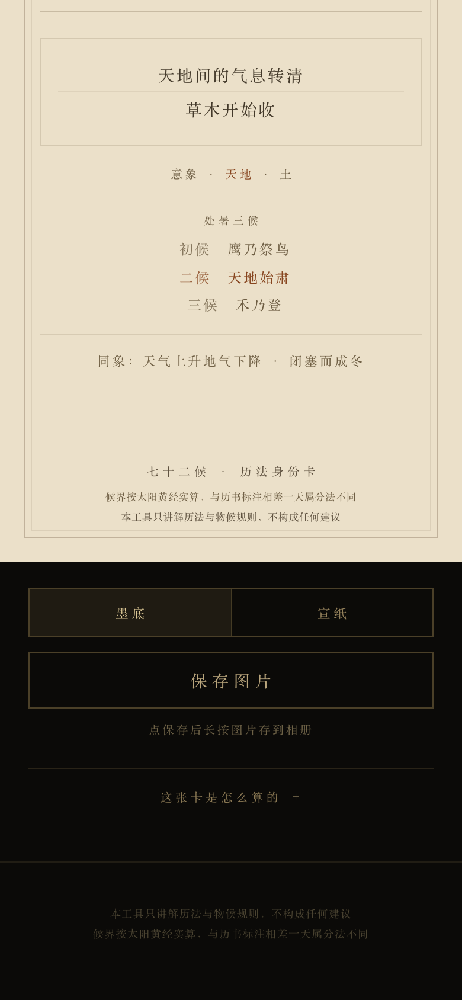

<div align="center">

# 你出生的那一候

**七十二候历法身份卡** — 输入出生年月日时，查出你落在二十四节气的哪一候，生成一张可保存的卡片。

纯静态 · 零依赖 · 离线可用 · 无网络请求

</div>

<table>
<tr>
<td></td>
<td></td>
<td></td>
<td></td>
</tr>
<tr>
<td align="center">开场选纸</td>
<td align="center">墨底金线</td>
<td align="center">宣纸墨字</td>
<td align="center">四季色温</td>
</tr>
</table>

## 它做什么

- **定位**：按太阳黄经实算的节气边界，把出生时刻落到 72 候中的某一候（1900–2050）。
- **成卡**：候名、节气、候序、物候原文、一句现代释义，排成一张竖卡。
- **存图**：纯前端 canvas 导出 2× PNG，不上传、不需要权限。
- **今日之候**：一键看"今天落在哪一候"。
- **两套纸**：墨底（金线）与宣纸（墨字），四季各有色温；开场先选亮/暗，整页与卡片一起换。

## 本地运行

不需要构建，直接打开即可：

```bash
open app/index.html
```

或起一个静态服务（手机上同局域网预览时用这个）：

```bash
python3 -m http.server 4173 --directory app
# http://127.0.0.1:4173/
```

## 数据与口径

| 项 | 说明 |
| --- | --- |
| 物候原文 | 《月令七十二候集解》（元·吴澄），简体文本取自古文岛（原古诗文网），**逐字未改** |
| 现代释义 | 原创改写，非古籍原文 |
| 节气边界 | 用 `ephem` 计算太阳视黄经，15° 一节气，每候 5 天，北京时间 UTC+8，分钟截断 |
| 覆盖范围 | 1900–2050，超出范围拒绝外推并明确提示 |
| 口径小字 | 候界按太阳黄经实算，与历书标注相差一天属分法不同 |

`hou72-final.json` 是最终数据集，`hou_terms.js` 是 1900–2050 的节气时刻表，运行时只查表、不做天文计算。

## 设计红线

1. **原文逐字不动**，只补现代释义，不改典籍。
2. **宁 null 不编**：拿不准的字段留空，不生成看起来合理的假内容。
3. **不做建议**：不出现吉/凶/运/福/灾/宜/忌一类字样，页面只讲历法与物候规则。
4. **离线优先**：无 CDN、无字体外链、无 `fetch`/XHR、无内联脚本、无 `eval`、无追踪。所有检查都在 `build.sh` 里作为闸门执行，任何一项不过就不出包。

## 目录

```
app/                可直接部署的静态站点（= zip 根目录内容）
  index.html
  assets/           app.js / capture.js / lookup.js / hou72-data.js / hou_terms.js
build.sh            打包 + 全部闸门（禁词、内联脚本、外部资源、体积、解压冒烟…）
build_app_data.py   hou72-final.json -> app/assets/hou72-data.js
build_terms.py      用 ephem 重算 1900–2050 节气表（需要 ephem）
hou72-final.json    72 候结构化数据（含原文、motif、出处）
hou_terms.js        节气时刻表（1899–2050）
tools/              Playwright + Node 验收测试与截图
APP-report.md       实现说明：设计、色板、对比度实测、闸门日志
DATA-report.md      数据说明：来源、motif 词表、家族拆分
DONE.txt            交付清单与验收记录
```

## 验收

```bash
./build.sh
```

依次跑：数据重建 → 查表单测 → 文件类型白名单 → 禁词全量扫描 → 内联脚本 → 网络/交互 API → 外部资源 → 必带项（viewport-fit、免责声明、口径小字）→ 体积 → 打包 → 解压冒烟 → 季节色温 → 墨/纸双版 → 开场与今日。全部通过才输出 `ziwei-hou.zip`。

测试用 Playwright（Chromium，390×844 @2x）跑真实页面，包含对比度实测（WCAG）、导出 PNG 像素抽样、"今日"的时钟覆盖，以及 375px 无横向滚动检查。跑测试需要先装 Playwright：

```bash
npm i -D playwright && npx playwright install chromium
```

## 已知限制

- 范围外（早于 1900 / 晚于 2050）不推算，直接提示。
- 候界与部分历书标注可能相差一天，属分法不同，页面已写明口径。
- "今天"取设备时钟的北京时间换算，设备时间不准则结果不准。
- 开场选的亮/暗不写入本地存储，刷新后回到默认（刻意不做持久化）。
- 开场遮罩用 `inert` 隔离背景，iOS 15.5 以下不支持该属性（会退化为视觉遮挡）。

## 免责声明

本工具只讲解历法与物候规则，不构成任何建议。
